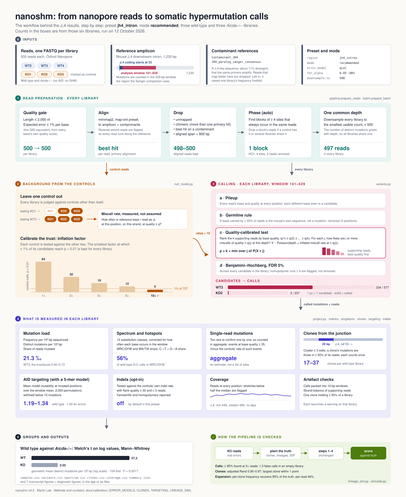

# SHMtrace

Somatic hypermutation measured from amplicon reads, on any platform: Oxford Nanopore, PacBio, Illumina or Sanger clones. Any targeted region works (the J꜀4 intron, V regions, switch regions), and real mutations are told apart from sequencing error using matched AID-deficient or empty-vector controls.

*Formerly nanoshm. `import nanoshm` still works, as an alias of `shmtrace`.*

You give it **reads + a reference FASTA** (optionally a contaminant FASTA). It gives you a variant table, unique-variant density, and the substitution spectrum: the same quantities reported in Aderinto & Martin.

It replaces the Geneious *assemble + find variants* step with [minimap2](https://github.com/lh3/minimap2) (via `mappy`) plus a variant caller that reimplements the manuscript's filtering rules explicitly, so every threshold is visible and adjustable rather than buried in a GUI.

> **Status: beta.** The default calling mode is quality-calibrated against your
> own mutation-free controls ([`ERROR_MODELS.md`](docs/calibration/ERROR_MODELS.md)).
> On the manuscript's J꜀4 libraries it reproduces Geneious-level wild-type signal
> with a quarter of its control background ([`GENEIOUS.md`](docs/calibration/GENEIOUS.md)).
> It has since been checked on data it was not tuned on: a public nanopore deposit
> from another laboratory ([`EXTERNAL_VALIDATION.md`](docs/calibration/EXTERNAL_VALIDATION.md)),
> an Illumina J꜀4 study whose published positive *and* negative findings both
> reproduce ([`ILLUMINA.md`](docs/calibration/ILLUMINA.md)), an ectopic-AID versus
> empty-vector experiment ([`ECTOPIC_AID.md`](docs/calibration/ECTOPIC_AID.md)), and
> matched Sanger clones from the same animals, whose substitution spectrum agrees
> at r = 0.95 ([`SANGER.md`](docs/calibration/SANGER.md)).
> Still validate against your own null control before publishing numbers.



## The app

Most people should use the desktop app: a window where you drop in your reads,
pick the region, and get figures and tables you can export. It runs entirely on
your own computer.

```bash
pip install -e ".[app]"
shmtrace-app
```

[`docs/USER_GUIDE.md`](docs/USER_GUIDE.md) walks through one experiment from
files to figures. [`packaging/BUILD.md`](packaging/BUILD.md) builds the
double-clickable `.app` or `.exe`.

The rest of this README is the command line, which does the same work and is
what the app calls underneath.

## Install

```bash
pip install -e ".[web]"        # drop [web] if you only want the CLI
```

Python 3.10+. The alignment backend is `mappy`, which ships minimap2 as a wheel, so there is nothing to compile.

## Single sample

```bash
SHMtrace \
  --fastq examples/WT3_JH4_sub500.fastq \
  --reference examples/JH4_reference.fasta \
  --contaminant examples/JH4_contaminant.fasta \
  --preset jh4_intron \
  --out results/WT3 --plots
```

Writes `summary.json`, `variants.csv`, and (with `--plots`) the spectrum, spatial map and mutation-load figures.

On the bundled example: **wild type ≈ 310 unique variants versus *Aicda*−/− ≈ 9** at 500 reads.

### Reproduce Geneious

`--mode geneious` applies the manuscript's rule: Geneious's approximate variant p-value, uncorrected at p ≤ 0.05, with no phasing. On the six bundled J꜀4 libraries it reproduces the manuscript's Geneious call counts to within 0–11 calls (`docs/calibration/GENEIOUS.md`). The default `recommended` mode (quality-calibrated against same-run controls) keeps Geneious-level WT calls (Jaccard 0.85–0.97) with a quarter of the Aicda-/- background.

### Benchmark a set of samples

```bash
shmtrace-benchmark --sheet examples_compare/samples.csv \
  --reference examples_compare/JH4_reference.fasta \
  --contaminant examples_compare/JH4_contaminant.fasta --preset jh4_intron --out bench
```

The sheet lists `sample, fastq, null, run, geneious_calls, geneious_export`. Every sample is analysed at one common depth. Each sample gets an empirical null from the other `null` rows of the same run. With Geneious exports the report also gives site-level precision, recall and Jaccard.

### Use a null control

If you have reads from a sample that should carry no somatic mutations, pass them with `--null`. The per-position error rate is measured from them directly instead of being assumed from base qualities, which on the J꜀4 data cut the held-out background by a further 40%:

```bash
SHMtrace --fastq WT.fastq --reference ref.fasta --preset jh4_intron \
        --null AID_KO_1.fastq --null AID_KO_2.fastq --out results/WT
```

**The control must come from the same sequencing run.** Nanopore error is run-specific, and a null fitted on another flow cell is not valid — `shmtrace` checks the run identifier in the read IDs and falls back to the read-quality model if they differ. So put a mutation-free sample on every flow cell; that is the same argument the manuscript makes for running an AID-null control alongside every experiment.

### Choose an error model

`--mode` picks how a site is judged against nanopore background. Every mode except `geneious` uses `--null` controls when given, and falls back to the read-quality test with a note when not.

| Mode | Test | Use when |
|---|---|---|
| `geneious` | Geneious's approximate p-value, uncorrected, p ≤ 0.05 | Reproducing Geneious numbers |
| `recommended` (= `qcal`) | Quality-calibrated: the control-measured rate of miscalls *at or above each supporting base's quality*, per substitution and strand, inflated by a factor calibrated on the controls themselves | The default. Without controls it falls back to the read-quality test |
| `v0.1` | Poisson/binomial on a per-position null from controls, BH-corrected | The old default |
| `strand` | Strand-aware beta-binomial: each strand tested against its own control rate, with overdispersion between libraries, combined by Fisher's method | Errors that show up on one strand |
| `pbinom` | Exact Poisson-binomial over every read's quality (LoFreq style) | No controls |

Add `+filter` to any mode (for example `qcal+filter`) to drop calls whose reads are split between strands far more unevenly than the column (`--strand-filter bias`; `both` instead requires a read on each strand). Every call carries plus/minus-strand read counts, a strand-bias p-value, the homopolymer run length and the 5-mer context; `--mask-homopolymers` drops calls in runs of 4 or more.

On the paper deposit, `qcal` matches Geneious in WT J꜀4 (Jaccard 0.85–0.97, 73 vs 75 ×10⁻⁵) with a quarter of its Aicda-/- background (192-fold vs 49-fold separation), and on N114 keeps 84% of Geneious's AID signal with no calls in any empty-vector control. On in-silico spike-ins into held-out controls, it finds 70% (J꜀4) and 85% (N114) of planted mutations with at most 0.3 false calls per sample, against Geneious's 93% and 88% recall with 2.7 and 6.0 false calls (`docs/calibration/ERROR_MODELS.md`). Check it on your own data with:

```bash
shmtrace-validate --control KO1.fastq --null KO2.fastq --null KO3.fastq \
  --reference ref.fasta --preset jh4_intron --profiles geneious,qcal,strand --out val
```

### Save a background panel

`--save-null-panel panel.json` writes the fitted null (per-site, per-strand and quality-tail rates, overdispersion and the calibration factor) and `--null-panel panel.json` reuses it. A panel is only valid for the same sequencing run and basecaller, so record both.

### Input formats

FASTQ, FASTA, Sanger `.ab1`/`.abi` traces, plain-text `.seq`, or BAM/SAM/CRAM, including Geneious's exported assemblies (`pip install -e ".[bam]"`). Any text format may be gzipped. FASTA and `.seq` carry no qualities, so every base is given Q30 (`io_utils.FASTA_DEFAULT_Q`). `--fastq` may also be a **directory** (every read file inside is one sample, e.g. a folder of Sanger clones; other files are skipped) or an **Illumina pair** written `R1.fastq.gz+R2.fastq.gz`. Inside a directory, files named alike except for `_R1`/`_R2` (or `_1`/`_2`) are merged as pairs automatically. From a BAM, secondary and supplementary records are skipped, reverse reads are turned back to the orientation they were sequenced in, and each read is used once.

## Platforms

`--platform` adapts a preset to the sequencer. Each preset keeps its assay settings (window, end trim, germline rule). Each platform sets the aligner and read filters:

| `--platform` | Aligner | Reads | Calling |
|---|---|---|---|
| `ont` (default) | `map-ont` | preset as written | `--mode` as usual |
| `pacbio` | `map-hifi` | preset as written | `--mode` as usual; BH counts every position × alt |
| `illumina` | `sr` | pairs merged on their overlap (≥ 20 bp, quality-aware consensus; pairs that don't overlap are dropped); EE gate 0.02; `min_align_len` ≤ 100 | `--mode` as usual; BH counts every position × alt |
| `sanger` | `map-ont` | Mott trim at Q20; `min_align_len` ≤ 200; no downsampling, no phasing | `sanger` mode: every substitution with base Q ≥ 20 is a call, with no statistical test |

Under Sanger each read is one clone. The germline rule (an alt in ≥ 50% of clones) applies only at positions covered by at least 4 clones. With fewer than 4 clones in the sample it is switched off and `summary.json` carries a note. Every platform writes `per_read.csv` (mutations and usable bases per read or clone) and a `mutation_load` block in `summary.json` (mutations per read, mutations per bp sequenced).

```bash
SHMtrace --fastq sanger_clones/ --reference ref.fasta --preset jh4_intron --platform sanger --out res/
SHMtrace --fastq lib_R1.fastq.gz+lib_R2.fastq.gz --reference ref.fasta --preset my_amplicon.yaml \
        --platform illumina --out res/
```

Short-read platforms cannot span a long-read amplicon, so give them an analysis window the reads actually cover.

### Sanger projects: a sample sheet and QC flags

For a Sanger project, a sample sheet names each trace's animal, group and control status, along with its sequencing order, well and tube label. Each run then checks the bookkeeping: misfiled clones, copied traces, contaminated controls, labels that name another animal, and lineages lost to the germline rule. Problems are flagged and nothing is changed. Validated on simulated projects with planted errors and on the lab's JH4 traces: [docs/calibration/SANGER_PIPELINE.md](docs/calibration/SANGER_PIPELINE.md).

```bash
shmtrace-sheet draft traces/ -o samplesheet.csv        # then check and edit every row
shmtrace-sheet run samplesheet.csv --reference ref.fasta --region jh4_intron -o results/
shmtrace-concordance results/project.json ont/project.json --labels Sanger,ONT
shmtrace-validate-sanger --reps 10 -o validation/
```

### More tools

| Command | What it does | Details |
|---|---|---|
| `umi = flank \| header` (setting) | One consensus read per molecule from UMIs | [UMI.md](docs/calibration/UMI.md) |
| `animal_tests` (in every result) | Group tests with the animal as the unit: negative binomial, permutation, Welch, fold with 95% CI | [REPLICATES_AND_POWER.md](docs/calibration/REPLICATES_AND_POWER.md) |
| `shmtrace-power` | How many animals and reads a comparison needs, from a pilot | [REPLICATES_AND_POWER.md](docs/calibration/REPLICATES_AND_POWER.md) |
| `shmtrace-repair` | Repair-route indices (UNG, MSH2/Pol η) and spectrum decomposition | [REPAIR.md](docs/calibration/REPAIR.md) |
| `shmtrace-switch` | Class-switch junctions: breakpoints, microhomology, insertions | [SWITCH.md](docs/calibration/SWITCH.md) |
| `barcode` column, `shmtrace-screen` | Pooled runs with inline barcodes; screens ranked by q-value | [MULTIPLEX.md](docs/calibration/MULTIPLEX.md) |

## Case versus control

`shmtrace-compare` does group comparison in the spirit of SHMTool ([MacCarthy et al., 2009](https://doi.org/10.1016/j.jim.2009.06.005)), but starting from raw FASTQ rather than pre-aligned sequences. Each file is one independent source, for example one mouse.

```bash
shmtrace-compare \
  --control examples_compare/WT2.fastq examples_compare/WT3.fastq examples_compare/WT4.fastq \
  --case    examples_compare/KO1.fastq examples_compare/KO2.fastq examples_compare/KO3.fastq \
  --reference examples_compare/JH4_reference.fasta \
  --contaminant examples_compare/JH4_contaminant.fasta \
  --preset jh4_intron --subregion 200-400 --plots \
  --out compare_results
```

Reports base-composition-corrected mutation frequencies with two-proportion tests, the A:T versus G:C breakdown, the 12-class spectrum, AID and Pol-η hotspot and coldspot targeting, WRC-versus-GYW strand bias, and an optional subregion against its complement.

## Web UI

```bash
uvicorn shmtrace.webapp.main:app --reload
# http://127.0.0.1:8000
```

Upload, adjust parameters with sliders, get the table and figures inline. Both the single-sample and comparison workflows are available.

## What it actually does

| Step | Geneious equivalent | Here |
|---|---|---|
| Map reads to reference | Geneious mapper | minimap2 `map-ont` via `mappy` |
| Remove contaminants | manual multi-reference map | index target + contaminant together, keep best hit |
| Drop chimeras | manual | discard supplementary alignments |
| Quality filter | Geneious trim | expected error ≤ 0.01/base (Q20-equivalent) |
| Depth normalisation | manual subsample | deterministic seeded downsample |
| Separate a second haplotype | manual phasing | co-occurrence blocks; dropped only if also seen in controls or another animal, otherwise flagged (a clone looks the same) |
| Call variants | "Find Variations" | pileup + per-column test, quality-derived or measured from controls |
| Multiple testing | none | Benjamini-Hochberg across all candidates |
| Remove germline | frequency < 50% rule | same rule, in `variants.py` |
| Significance filter | approximate p ≤ 0.05 | `--mode geneious`: the same test; default: Poisson/binomial test on base qualities or a measured null, BH-corrected |
| Density and spectrum | Prism, by hand | `metrics.py` |

Indels are excluded throughout: this is a substitution-focused tool, matching the assay it was built for.

## Presets

`jh4_intron` and `n114_vregion` ship with the package and are selected by name. Every field is overridable on the CLI or in the web UI, and a preset is just a YAML file, so a new assay means a new file rather than new code:

```bash
SHMtrace --preset my_locus.yaml ...      # a path works too
```

Parameters are documented in `src/shmtrace/config.py`; each one maps to a single control in the UI.

## Layout

```
src/shmtrace/
  config.py        parameter model + preset loading
  io_utils.py      FASTQ/FASTA/AB1/BAM readers, pair merging, trimming, EE maths
  align.py         competitive minimap2 alignment
  reads_filter.py  EE/length gate + downsampling
  variants.py      quality-aware SNV caller + the paper's filter rules
  metrics.py       unique-variant density, spectrum, G:C bias
  motifs.py        AID/Pol-η hotspot and coldspot scoring
  compare.py       case-vs-control statistics
  viz.py           publication-style figures
  pipeline.py      orchestration + CLI
  presets/         jh4_intron.yaml, n114_vregion.yaml
  webapp/          FastAPI backend + single-page UI
tests/             pytest suite
examples/          bundled WT and Aicda-/- reads
docs/ROADMAP.md    architecture, phases, validation plan
```

The engine is a plain importable library with no web dependencies. The web layer never does science: it marshals uploads and parameters into `shmtrace.pipeline.run()` and formats the result. That is what makes "local now, hosted later" cheap.

## Development

```bash
pip install -e ".[dev,web]"
pytest
ruff check src tests
```

See [`CONTRIBUTING.md`](CONTRIBUTING.md).

## Citing

If you use this tool, please cite the manuscript it was built for:

> Aderinto, A. & Martin, A. High-confidence profiling of somatic hypermutation in immunoglobulin variable regions and the J꜀4 intron using Oxford Nanopore R10.4 sequencing.

## Licence

MIT. See [`LICENSE`](LICENSE).
